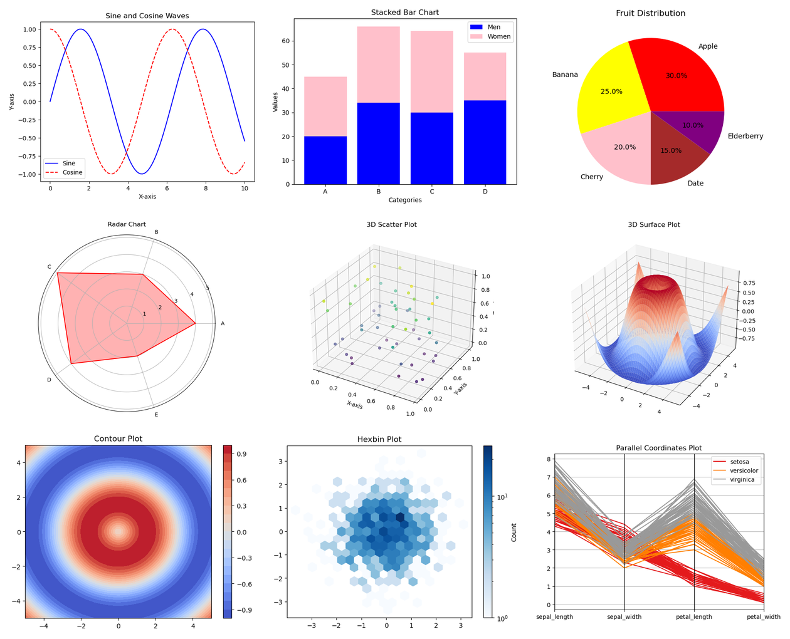

# Data EDA and Visualization

Exploratory Data Analysis (EDA) and data visualization in Python, covering
the main chart types in Matplotlib, Seaborn and Plotly.



*A few of the charts from the notebooks: line, stacked bar, pie, radar, 3D scatter, 3D surface, contour, hexbin and parallel coordinates.*

## Charts covered

- Line plot, multiple line plot
- Bar chart (vertical and horizontal), stacked bar chart
- Scatter plot
- Histogram
- Pie chart
- Box plot
- Error bar plot
- Subplots
- Filled area chart
- Radar chart
- 3D scatter plot and 3D surface plot
- Contour plot
- Hexbin plot
- Polar plot
- Parallel coordinates

The PDF also includes short NumPy and Pandas primers (array operations,
DataFrame inspection, cleaning, grouping and merging) used in the EDA workflow.

## Files

| File | Description |
|------|-------------|
| `Data EDA & Visualization with all types of visualization.pdf` | Printed Jupyter notebooks (47 pages) with code and outputs |
| `requirements.txt` | Python packages used in the notebooks |

## Datasets

The Pandas section of the PDF reads `cars_data.csv` and a few related CSV
files that are **not stored in this repository**. The chart examples build
their own data with NumPy and run without any external files.

## How to run

```bash
pip install -r requirements.txt
jupyter notebook
```

## Tools

Python, NumPy, Pandas, Matplotlib, Seaborn, Plotly

## Use cases

- College project
- Internship submission
- Resume and GitHub portfolio

## License

MIT, see [LICENSE](LICENSE).
